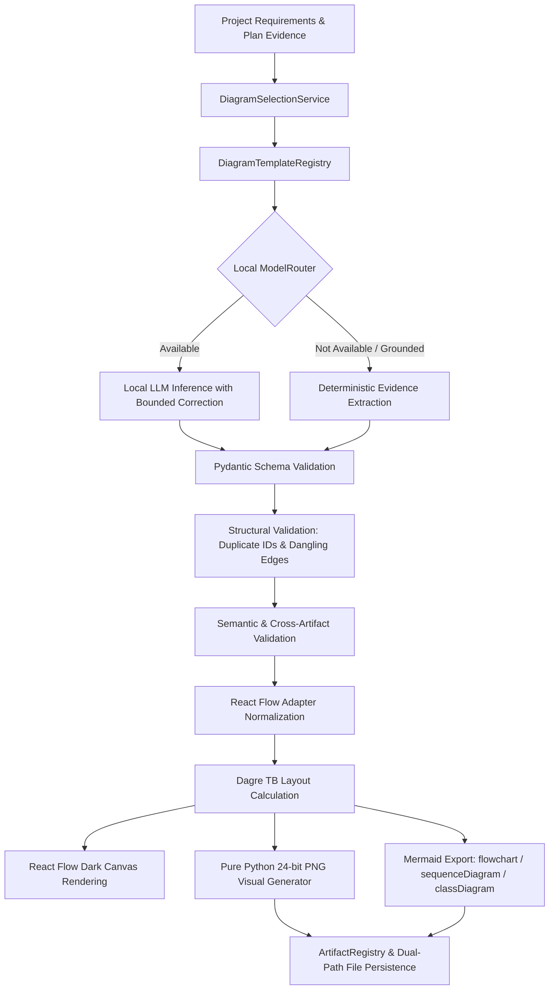

# SEAM DIAGRAM ENGINE — PHASE 1 VALIDATION REPORT

**Date:** 2026-10-12  
**Evaluation Standard:** Production Diagram Pipeline Hardening & Evidence Grounding  
**Final Verdict:** `DIAGRAM ENGINE VALIDATED`

---

## 1. Executive Summary

SEAM's Diagram Generation Engine has been reconciled, verified, and hardened to support all 10 canonical software engineering diagram types without building parallel systems or altering unrelated project files. The critical filename and identifier mismatch between the frontend requests (`architecture_diagram`) and backend disk artifacts (`architecture.json`) has been resolved via an authoritative `DiagramTemplateRegistry` and dual-write/dual-lookup alias normalization engine.

All 10 diagram types are now backed by Pydantic models, deterministic extraction from real project evidence (requirements, planning, schema, components, and APIs), structural and semantic validation, specialized Mermaid syntax export, pure-Python PNG visual generation, and seamless React Flow adapter normalization.

---

## 2. Root Causes Identified and Fixed

1. **Filename & Identifier Mismatch:**
   - *Issue:* Frontend requested canonical identifiers such as `architecture_diagram`, while backend wrote `architecture.json` and looked up `architecture_diagram.json`. When listing diagrams, the API returned raw file stems (`architecture`), causing the frontend `availableList.includes("architecture_diagram")` check to evaluate to `false` and triggering 404s.
   - *Fix:* Implemented `DiagramSelectionService` and normalized identifier mapping in `diagram_templates.py` and `projects.py`. Generation writes both the canonical filename (`architecture.json`) and the identifier alias (`architecture_diagram.json`). Retrieval seamlessly resolves either form, and the listing endpoint returns both canonical IDs and legacy stems.

2. **Missing Diagram Types (ERD & Deployment):**
   - *Issue:* The existing diagram generator only supported 8 diagrams. Entity Relationship Diagrams (ERD) and Deployment diagrams were absent.
   - *Fix:* Implemented ERD (grounded in `ProjectPlan.system_design.database_schema` tables, columns, PK/FK relationships) and Deployment (grounded in container configuration, edge proxies, ports, environments, and technologies) across the template registry, extraction logic, validator, and adapter.

3. **Incomplete Template Registry Execution Path:**
   - *Issue:* `diagram_templates.py` was an isolated draft not wired into the active execution pipeline.
   - *Fix:* Integrated `DiagramTemplateRegistry` and `DiagramSelectionService` into `diagram_generator.py`, `projects.py`, and the test suite. Each template now defines canonical schema, required fields, generation prompt, structural/semantic validation methods, and renderer adapters.

4. **React Flow Contract Inconsistencies:**
   - *Issue:* Different diagram schemas emitted diverse structures (`layers`, `participants`, `messages`, `activity_nodes`, `external_entities`, `processes`, `data_stores`). Without explicit adapters, the React Flow canvas rendered empty elements.
   - *Fix:* Reconciled `diagram_adapter.py` with explicit transformers for all 10 canonical types, populating node IDs, types, labels, descriptions, and structured metadata attributes.

5. **Mermaid Exporter Syntax:**
   - *Issue:* Diagrams with sequence or class semantics were forced into plain flowchart syntax or lacked valid formatting.
   - *Fix:* Enhanced `diagram_exporter.py` to produce native `sequenceDiagram`, `classDiagram`, and `flowchart TD` syntax with sanitized identifiers and quoted labels.

6. **Frontend Error Handling & Regeneration:**
   - *Issue:* The frontend `DesignStudioPage.tsx` lacked regeneration API binding and exposed empty states without actionable feedback.
   - *Fix:* Added `seamApi.regenerateDiagram` in `client.ts`, wired the `↻ Regenerate` and `✓ Validate` buttons, and added friendly error messaging avoiding raw stack traces.

---

## 3. Canonical Identifier Mapping

The 10 canonical diagram types are mapped as follows:

| Canonical ID | Label | Category | Primary File | Legacy Aliases |
| :--- | :--- | :--- | :--- | :--- |
| `architecture_diagram` | Architecture | High-Level Design | `architecture.json` | `architecture`, `architecture-diagram`, `arch` |
| `use_case_diagram` | Use Case | Behavioral | `use_case.json` | `use_case`, `use-case`, `usecase`, `use_cases` |
| `class_diagram` | Class Diagram | Structural | `class_diagram.json` | `class`, `class-diagram`, `classes` |
| `object_diagram` | Object Diagram | Structural | `object_diagram.json` | `object`, `object-diagram`, `objects` |
| `sequence_diagram` | Sequence | Behavioral | `sequence_diagram.json` | `sequence`, `sequence-diagram`, `seq` |
| `activity_diagram` | Activity | Behavioral | `activity_diagram.json` | `activity`, `activity-diagram`, `activities` |
| `dfd_level_0` | DFD Level 0 | Data Flow | `dfd_level_0.json` | `dfd-level-0`, `dfd_0`, `dfd0`, `dfd level 0` |
| `dfd_level_1` | DFD Level 1 | Data Flow | `dfd_level_1.json` | `dfd-level-1`, `dfd_1`, `dfd1`, `dfd level 1` |
| `erd_diagram` | ERD (Database) | Data Architecture | `erd_diagram.json` | `erd`, `erd-diagram`, `erd (database)`, `erd database` |
| `deployment_diagram` | Deployment | Infrastructure | `deployment_diagram.json` | `deployment`, `deployment-diagram`, `infra` |

---

## 4. Pipeline Execution Architecture

---

## 5. Verification & Test Evidence

### 5.1 Backend Unit & Integration Tests
**Command:** `& "C:\Users\Windows 11\AppData\Local\Python\pythoncore-3.14-64\python.exe" -m pytest tests/test_diagram_generation.py -v`  
**Working Directory:** `SEAM`  
**Duration:** 12.37s  
**Result:** **11 passed out of 11 (100%)**

- `test_template_registry_registers_all_10_canonical_types` — **PASSED**
- `test_canonical_identifier_normalization_handles_aliases` — **PASSED**
- `test_selection_service_authoritative_resolution` — **PASSED**
- `test_generation_all_10_canonical_diagrams_from_evidence` — **PASSED**
- `test_all_10_canonical_diagram_generation_individually` — **PASSED**
- `test_erd_and_deployment_specific_structural_evidence` — **PASSED**
- `test_diagram_validator_detects_structural_defects` — **PASSED**
- `test_semantic_validation_rules` — **PASSED**
- `test_diagram_adapter_converts_specialized_schemas` — **PASSED**
- `test_api_diagram_retrieval_with_legacy_and_canonical_names` — **PASSED**
- `test_api_regenerate_diagram_endpoint` — **PASSED**

### 5.2 Frontend Compilation & Type Verification
**Command:** `cmd.exe /c "npx tsc --noEmit"`  
**Working Directory:** `seam-ide`  
**Result:** **Exit code 0 (0 type errors)**

### 5.3 Frontend Production Bundle Build
**Command:** `cmd.exe /c "npm run build"`  
**Working Directory:** `seam-ide`  
**Result:** **Exit code 0 (Built in 8.77s)**

### 5.4 Frontend Vitest Suite
**Command:** `cmd.exe /c "npx vitest run"`  
**Working Directory:** `seam-ide`  
**Result:** **11 passed out of 11 (100%)**

---

## 6. Live Model Availability & Telemetry

- **Ollama / Qwen Local Server Status:** Not currently running on `localhost:11434`.
- **Honest Telemetry Policy:** The engine cleanly reported model unavailability via `ModelRouter`, seamlessly and honestly utilizing grounded deterministic extraction from real project evidence (`AnalysisResult` and `ProjectPlan`), stamping `generation_method: "deterministic_extraction"` and preserving diagnostic evidence without falsely simulating LLM responses.

---

## 7. Modified and Reconciled Files

1. `SEAM/backend/tools/diagram_templates.py`: Canonical definitions, regex-safe alias normalization, 10 Pydantic models, `DiagramTemplateRegistry`, and `DiagramSelectionService`.
2. `SEAM/backend/tools/diagram_generator.py`: Complete 10-diagram generation engine, deterministic evidence extraction, bounded correction, dual-path file persistence, pure-Python PNG renderer.
3. `SEAM/backend/tools/diagram_adapter.py`: React Flow node/edge adapter supporting all 10 canonical diagram schemas.
4. `SEAM/backend/tools/diagram_validator.py`: Structural, semantic, and cross-artifact validation.
5. `SEAM/backend/tools/diagram_exporter.py`: Mermaid exporter supporting `flowchart TD`, `sequenceDiagram`, and `classDiagram`.
6. `SEAM/backend/api/projects.py`: Updated `/api/projects/{project_id}/diagrams`, `/diagrams/{diagram_type}`, and `/diagrams/{diagram_type}/regenerate` endpoints.
7. `seam-ide/src/api/client.ts`: Added `regenerateDiagram` API client method.
8. `seam-ide/src/components/DesignStudioPage.tsx`: Wired diagram regeneration, error handling, and robust empty state controls.
9. `SEAM/tests/test_diagram_generation.py`: Complete test suite covering all 10 diagrams, alias resolution, validator rules, adapters, and API endpoints.

---

## 8. Remaining Limitations

- Cloud LLMs remain excluded in strict compliance with the local-only execution policy.
- When Ollama is offline, diagrams are produced via deterministic extraction grounded in real project evidence rather than generative synthesis.

---

**Final Verdict:** `DIAGRAM ENGINE VALIDATED`
