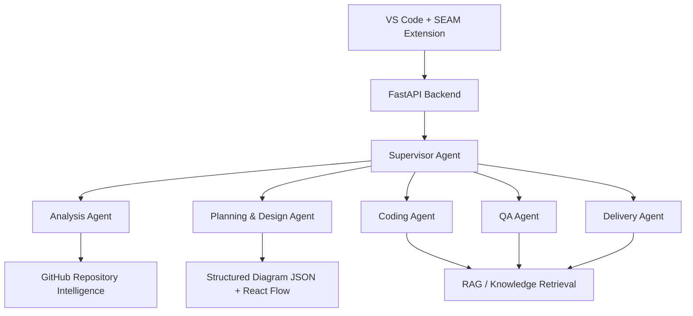

# SEAM Architecture

## Overview
SEAM (Self-Evolving Autonomous Multi-Agent Framework) is an end-to-end autonomous software engineering system. 

## Component Diagram

## The Six-Agent Architecture
1. **Analysis Agent**: Converts natural language into structured requirements (`FR`, `NFR`).
2. **Planning & Design Agent**: Consumes requirements to generate architecture, diagrams, and task dependency graphs.
3. **Supervisor / Orchestrator Agent**: Controls the workflow, enforces constraints, and tracks state.
4. **Coding Agent**: Generates application code safely within `generated_projects/` via `qwen3-coder-next`.
5. **QA Agent**: Validates implementation deterministically and semantically. Feeds back to Coding Agent if `FAIL`.
6. **Delivery Agent**: Packages the final project and injects validated lessons into ChromaDB.

## Shared Infrastructure
- **LLM Routing**: `ModelRouter` manages Qwen models via Ollama.
- **Knowledge Repository**: RAG via ChromaDB and `fastembed`. Enforces PENDING -> VALIDATED lifecycle.
- **GitHub Intelligence**: Analyzes repositories for deterministic code reuse scoring.
- **Visual Diagrams**: Planning/design produces structured diagram JSON for visual rendering in the VS Code extension.
