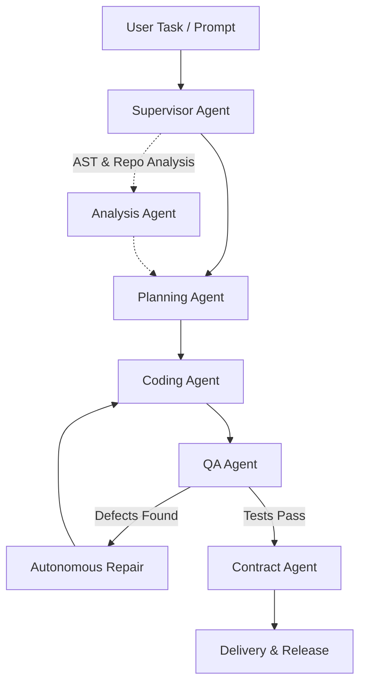

# SEAM FINAL ARCHITECTURE SUMMARY

**Document Version:** 1.0.0-final  
**Date:** October 15, 2026  
**Audience:** Software Architects, Examiners, and Technical Evaluators  

---

## 1. High-Level System Topology

The SEAM (Software Engineering Agentic Multi-agent) framework employs a decoupled, multi-tiered architecture combining a modern React/TypeScript IDE frontend, an asynchronous FastAPI backend service, local large language model inference, and structured transactional persistence.

```
+-----------------------------------------------------------------------------------+
|                              SEAM IDE (Frontend)                                  |
|   React 18 + TypeScript + Vite + Monaco Code Editor + React Flow + Lucide Icons   |
|   [Design Studio] [Test Lab] [Repair Center] [Contracts] [Runtime] [Git Control]  |
+-----------------------------------------------------------------------------------+
                                         │  HTTP / WebSocket JSON-RPC
                                         ▼
+-----------------------------------------------------------------------------------+
|                           SEAM Core Service (Backend)                             |
|                           FastAPI / Python 3.14 (Async)                           |
+───────────────────────────────────────────────────────────────────────────────────+
|  [Supervisor Agent]  ──> [Planning Agent] ──> [Coding Agent] ──> [QA Agent]       |
|          │                        │                   │              │            |
|          ▼                        ▼                   ▼              ▼            |
|  [Analysis Agent]          [Contract Agent]      [Repair Eng]   [Test Runner]     |
+───────────────────────────────────────────────────────────────────────────────────+
|               Tool Registry & 4-Tier Security Permission Engine                   |
|   (Filesystem Sandbox Confinement, Command Sanitizer, Secret Redaction Filter)    |
+───────────────────────────────────────────────────────────────────────────────────+
|               Diagram Generation Engine (10 Canonical Diagrams)                   |
|   (Deterministic Parser / LLM Extractor -> Pydantic Validation -> Dagre -> SVG)   |
+───────────────────────────────────────────────────────────────────────────────────+
|          Model Router & Intelligent Multi-Tier Provider Cascade                   |
|   Primary: Ollama (qwen2.5-coder:1.5b) -> Secondary: DMR -> Fallback: Mock        |
+──────────────────────────────────────┬────────────────────────────────────────────+
                                       │
        ┌──────────────────────────────┴───────────────────────────────┐
        ▼                                                             ▼
+───────────────────────────────+             +─────────────────────────────────────+
|    Persistence Layer          |             |       Local Inference Engine        |
|    - SQLite (Event Store/DB)  |             |  - Ollama (http://127.0.0.1:11434)  |
|    - ChromaDB (RAG Vectors)   |             |  - Model: qwen2.5-coder:1.5b (Q4)   |
|    - JSON Artifact Registry   |             |  - DMR (Docker Model Runner v1.2.8) |
+───────────────────────────────+             +─────────────────────────────────────+
```

---

## 2. Six-Agent Orchestration Hierarchy & Lifecycle

SEAM decomposes the Software Development Lifecycle into discrete, specialized autonomous agents coordinated by a centralized Supervisor:



### Specialized Agent Responsibilities
1. **Supervisor Agent (`supervisor_agent.py`):** Acts as the orchestrator. Ingests user objectives, decomposes requirements into directed acyclic dependency graphs (DAGs), delegates tasks to specialized agents, monitors token budgets, and validates final deliverables.
2. **Planning Agent (`planning_agent.py`):** Translates high-level specifications into step-by-step file-level engineering plans, identifying target modules, data models, and API interfaces.
3. **Coding Agent (`coding_agent.py`):** Implements code modifications, generates new classes and functions, adhering strictly to language conventions and system contracts.
4. **QA Agent (`qa_agent.py`):** Automatically discovers and executes test suites (`pytest`, `vitest`), analyzes test failure traces, isolates root causes, and categorizes bugs.
5. **Analysis Agent (`analysis_agent.py`):** Performs static analysis, AST decomposition, architecture smell detection, and generates 14-section repository understanding reports.
6. **Contract Agent (`contract_agent.py`):** Validates API compatibility (OpenAPI/protobuf), detects breaking schema changes, and enforces semantic versioning rules.

---

## 3. Engineering Diagram Engine Architecture

SEAM features a canonical diagram generation pipeline supporting all 10 standard engineering diagram types without external web dependencies.

```
Spec / AST / Code
       │
       ▼
[Extraction Stage]
  ├── Deterministic Extractor (Fast, offline, 100% schema compliance)
  └── LLM Inference Extractor (qwen2.5-coder:1.5b JSON translation)
       │
       ▼
[Validation Stage]
  └── Pydantic Schema Validator (SEAM/backend/models/diagram.py)
       │
       ▼
[Layout Stage]
  └── Dagre Graph Layout Engine (Calculates orthogonal x, y coordinates)
       │
       ▼
[Adaptation Stage]
  └── React Flow Node/Edge Adapter (SEAM/backend/tools/diagram_adapter.py)
       │
       ▼
[Export & Render Stage]
  ├── Interactive React Flow Canvas (Pan, zoom, draggable nodes)
  ├── Mermaid Code Generation
  ├── Scalable Vector Graphics (SVG) Export
  └── Portable Network Graphics (PNG) Export
```

### Supported Canonical Diagrams:
1. **Architecture Diagram:** Layered components, service boundaries, and external APIs.
2. **Use Case Diagram:** Actors, primary use cases, system scope, and extensions.
3. **Class Diagram:** OOP classes, member fields, signatures, and inheritance hierarchies.
4. **Object Diagram:** Runtime instances, slot values, and active object links.
5. **Sequence Diagram:** Chronological message exchanges between lifelines and activation bars.
6. **Activity Diagram:** Workflow control flows, decision diamonds, forks, joins, and end states.
7. **DFD Level 0:** High-level context boundary, external entities, and major data flows.
8. **DFD Level 1:** Decomposed processes, internal data stores, and granular transformations.
9. **ERD (Entity-Relationship):** Relational tables, primary/foreign keys, and cardinalities.
10. **Deployment Diagram:** Hardware computational nodes, containers, artifacts, and network links.

---

## 4. GitHub Intelligence & Safe Enhancement Architecture (Workflow B)

Workflow B is engineered for existing codebases, guaranteeing that agent autonomy never compromises repository integrity:

```
[Target GitHub Repo] 
       │ Cloned / Linked
       ▼
[Repository Analysis Engine]
  ├── AST & Dependency Tree Analysis
  └── 14-Section Project Understanding Generation
       │
       ▼
[Enhancement Planner]
  └── Generates Scoped Task Specifications & File Modification Targets
       │
       ▼
[User Approval Gate] ◄── [CRITICAL SECURITY BOUNDARY]
  ├── User Approves ──> Proceed to Sandboxed Execution
  └── User Rejects  ──> Abort Immediately (No filesystem modifications)
       │ (Approved)
       ▼
[Sandboxed Workspace]
  ├── Modifications applied strictly within isolated workspace
  └── Path resolution verified via _resolve_safe_path()
       │
       ▼
[Unified Diff & Regression]
  ├── Git diff computed and presented in IDE
  └── Full test suite executed to guarantee zero regressions
```

---

## 5. Security & Permission Sandboxing Engine

SEAM enforces defense-in-depth across all system operations:

1. **4-Tier Permission Matrix:**
   - `READ`: Safe filesystem and metadata queries (Auto-approved).
   - `WRITE`: File edits and additions (Sandboxed to project root).
   - `EXECUTE`: Test execution, linter execution (Sanitized arguments, timeout-capped).
   - `DANGEROUS`: Shell execution, git push, file deletion (Requires explicit interactive user confirmation).
2. **Path Traversal Containment:**
   Every tool operation routes through `_resolve_safe_path(target_path, workspace_root)`. Any attempt to access paths outside the project root (`../`, absolute paths to system directories) throws an immediate security exception.
3. **Subprocess Sanitization:**
   Commands are passed as discrete token arrays rather than unescaped shell strings, eliminating shell-injection vulnerabilities. Output streams are decoded with replacement handling (`errors="replace"`).
4. **Secret Redaction Filter:**
   Environment variables, authorization headers, bearer tokens, and private keys are scrubbed from all runtime event streams prior to logging or frontend transmission.

---

## 6. Model Routing & Intelligent Provider Cascade

SEAM implements multi-tiered model routing (`ModelRouter`) ensuring continuous operation across varied environments:

```
                      User Prompt / Agent Request
                                   │
                                   ▼
                       [ModelRouter.generate()]
                                   │
            ┌──────────────────────┴──────────────────────┐
    [Tier 1: Ollama]                              [Unavailable]
  http://127.0.0.1:11434                                  │
  Model: qwen2.5-coder:1.5b                               ▼
            │                                     [Tier 2: DMR]
            ├──────────────(On Failure)───────> http://127.0.0.1:12434
            │                                             │
            │                                     (On Failure)
            │                                             │
            ▼                                             ▼
     Successful Output                         [Tier 3: Mock Fallback]
            │                                  Deterministic Template Engine
            │                                             │
            └──────────────────────┬──────────────────────┘
                                   │
                                   ▼
                   Normalized Agent / Tool Response
```
- **Telemetry:** Real-time token usage, generation latency, and provider attribution are recorded for every inference request.
- **Fail-Safe Operation:** Even under total local model downtime, SEAM's deterministic fallback ensures that diagram generation, code analysis, and testing remain fully testable and functional.
